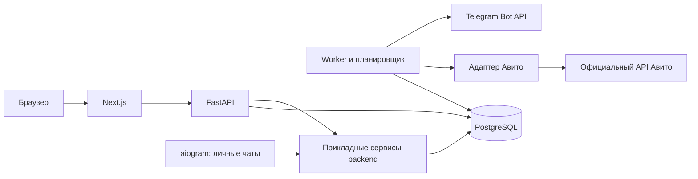

# Архитектура

Статус: проектное решение для беты; реализован начальный каркас без клиентских данных. Границы этапа 1 — [ADR 0001](docs/adr/0001-scaffold-boundaries.md), визуальные правила — [дизайн-система](docs/DESIGN_SYSTEM.md). Обязательные инварианты — в AGENTS.md; модель хранения — в DATABASE_DESIGN.md.

## Состав системы



Один backend-код и схема домена, несколько процессов для разных нагрузок. Worker и бот вызывают те же прикладные сервисы, что API; не обращаются к чужим таблицам в обход их правил. Разделение процессов не означает микросервисы.

Next.js обслуживает интерфейс; бизнес-логика, права и формулы находятся в FastAPI/backend. Предпочтительно единое origin через reverse proxy: `/api` направляется в FastAPI. Серверные запросы Next.js передают контекст сессии; пользовательские ответы не попадают в общий публичный кеш. Прямых вызовов Авито из браузера нет.

## Модули монолита

| Модуль | Ответственность |
|---|---|
| identity | Пользователи, подтверждение email, пароли, сессии, восстановление |
| tenancy | Организации, членство, роли, приглашения |
| integrations | Подключения, права провайдера, шифрованные секреты, OAuth, состояние связи |
| ingestion | Планирование сборов, checkpoint, задачи, нормализация |
| analytics | Версии метрик, расходы, обращения, CPL, покрытие |
| notifications | Telegram-привязки, правила, outbox и доставки |
| audit | Действия, влияющие на доступ, настройки и интеграции |

Модули обмениваются сервисными интерфейсами/типизированными событиями. Общая БД допустима; произвольные изменения чужих таблиц запрещены. Событие изменения и запись в outbox создаются в одной транзакции.

Предлагаемая структура после этапа каркаса:

```text
apps/web/
backend/src/avitopulse/
  modules/{identity,tenancy,integrations,ingestion,analytics,notifications,audit}/
  entrypoints/{api,worker,bot}/
  shared/{db,config,security,observability}/
backend/migrations/
backend/tests/
docs/adr/
infra/
```

Shared содержит инфраструктуру, не универсальный склад бизнес-логики. REST-контракт собственного API версионируется; фронтенд получает типы из OpenAPI FastAPI. Конкретные маршруты проектируются при реализации сценариев.

## Доверие и авторизация

1. Middleware проверяет хеш серверной сессии, её срок и отзыв.
2. Пользователь выбирает организацию; tenancy проверяет активное членство и роль на каждое действие.
3. Репозиторий открывает короткую транзакцию и задаёт transaction-local organization_id, полученный после проверки.
4. RLS ограничивает tenant-таблицы. Без контекста данные недоступны. Составные внешние ключи исключают связи с другой организацией.
5. Ответы, ошибки и логи не раскрывают существование чужих объектов; чужой объект выдаётся как недоступный/не найденный по единой политике.

RLS защищает от пропущенного фильтра, но не заменяет проверку членства и не является защитой от полного захвата backend. Глобальные identity/tenancy-операции выполняются через узкий слой без произвольного доступа к аналитике. Нельзя выдавать runtime-ролям возможность обходить RLS ради bootstrap.

Перенос соединения из пула между запросами не сохраняет tenant-контекст. Для бота контекст берётся из подтверждённой привязки, затем проверяется членство; произвольный organization_id из команды не принимается без проверки. Удаление участника отзывает сессии/привязки в соответствующем контексте и отменяет его доставки.

## Интеграция Авито

Официальный адаптер скрывает контракт провайдера. Предварительные внутренние возможности: определить владельца аккаунта, проверить доступ, получить подтверждённые метрики за интервал. Наличие интерфейса не означает наличие соответствующего внешнего метода.

Capability registry хранит результат проверки отдельно для подключения и типа данных: unknown / verified / unavailable, причину и время проверки. Ошибка запроса не превращает capability в verified. UI не обещает показатель, отсутствующий у данного аккаунта.

Если подтвердится OAuth для стороннего приложения: одноразовый state связан с действующим пользователем, сессией, организацией, URI и TTL; callback перепроверяет роль, затем сохраняет зашифрованные credentials. Обмен и refresh используют подтверждённую спецификацию. Конкурирующее обновление токена сериализуется блокировкой; версия credentials меняется атомарно.

Поиск OAuth-попытки по хешу state и Telegram-привязки по хешу одноразового кода выполняется узким служебным методом: он возвращает только контекст попытки после проверки срока и не открывает произвольный доступ к tenant-таблицам. Одноразовое погашение и создание связи выполняются атомарно; знание кода не отменяет проверки инициатора и разрешённого получателя.

Если доступен только иной способ авторизации, он внедряется отдельным ADR после проверки пригодности для SaaS. Запрашивать логин/пароль Авито или объявлять client_credentials подходящим для чужих аккаунтов без доказательства нельзя.

При отключении увеличивается authorization_version, сборы и доставки отменяются, секреты удаляются/отзываются доступным способом. Worker проверяет версию до запроса и перед сохранением результата: запоздавший ответ от отключённого подключения не становится новыми данными.

## Сбор и расчёты

Планировщик добавляет задания по подтверждённой частоте и лимитам, с jitter. PostgreSQL-очередь использует короткую выдачу lease через `FOR UPDATE SKIP LOCKED`, время окончания аренды, heartbeat, ограничение попыток и ручную обработку окончательных ошибок. Lease выдаётся в короткой транзакции; сетевой вызов не держит блокировку БД.

Глобальный диспетчер видит лишь разрешённые поля очереди через отдельную роль/ограниченные процедуры, без аналитики и секретов. Обработка задания выполняется уже под конкретным tenant-контекстом. Версия разрешения и допустимость подключения перепроверяются.

Сбор имеет идемпотентный ключ (организация, подключение, набор данных, интервал, версия схемы). Пересекающиеся задания одного потока сериализуются. Checkpoint двигается только после надёжного сохранения страницы/интервала. Повтор делает upsert актуального значения, а не прибавляет повторно дельту.

Поздние исправления источника учитываются повторным сбором скользящего окна; размер окна определяется исследованием. Интервалы, которые API возвращает только общей суммой, не делятся искусственно на дни. Для них аналитика ограничивается доступной гранулярностью.

Timeout, ограниченные повторы с exponential backoff и jitter, учёт подтверждённых рекомендаций провайдера. 429 замедляет сбор; 401 допускает один цикл восстановления авторизации, затем reauth_required; 403 требует проверки прав/тарифа, а не бесконечного повтора; временные сетевые/5xx ошибки повторяются ограниченно. Это внутренняя политика обработки HTTP, а не утверждение о конкретных ответах Авито.

## Telegram и outbox

В бете бот принимает команды через long polling; один активный poller, bot token в хранилище секретов. При переходе на webhook нужна отдельная проверка подлинности входящих запросов.

Привязка: пользователь в кабинете создаёт короткоживущий одноразовый код → открывает личный чат → бот атомарно погашает хеш кода и связывает Telegram user/chat с пользователем и организацией. Разрешено несколько организационных привязок одному пользователю; выбор организации явный. Код не содержит секретов интеграции.

Worker оценивает правила на полных данных, записывает событие и outbox, затем доставляет. Непосредственно перед отправкой проверяет активность пользователя, членство, правило и привязку. Неуспешные отправки имеют retry/cooldown и финальный статус; запрет отправки пользователем отключает канал. Неоднозначный timeout может дать повтор, что отражается в диагностике доставки.

## Эксплуатация

- Отдельные среды dev/staging/production, разные базы и секреты; staging не копирует реальные токены.
- TLS, закрытый сетевой доступ к БД, минимальные права runtime, ротация ключей и контролируемый доступ оператора.
- Структурированные логи с request/job id; метрики успешности и длительности сборов, лаг очереди, возраст данных и ошибки доставки. Tenant-id не становится меткой с неограниченной кардинальностью в общей системе метрик.
- Health/readiness без секретов. Оповещения оператору о системных сбоях отдельно от клиентских уведомлений.
- Зашифрованные резервные копии и проверка восстановления в изолированной среде; ключи шифрования восстанавливаются отдельным контролируемым способом.
- Перед бетой определить RPO/RTO, сроки хранения, процедуру удаления организации, восстановление после сбоя и откат релиза. Миграции по модели expand/migrate/contract.

Безопасная деградация: кабинет показывает последнюю успешную статистику с её возрастом; новое вычисление CPL при недостаточных данных не производится. При отсутствии подтверждённого API доступен только явно обозначенный демонстрационный режим.
